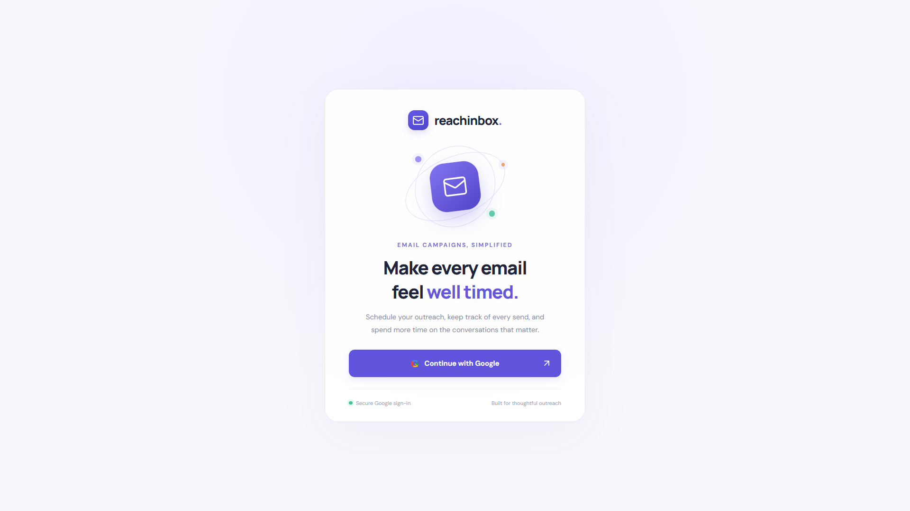
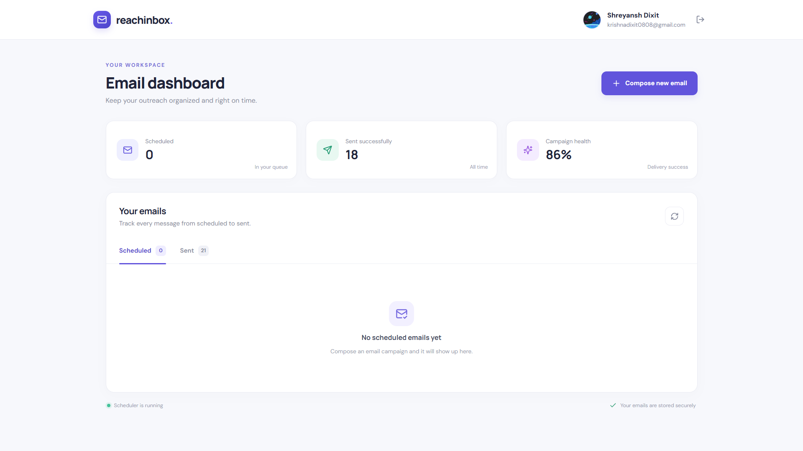
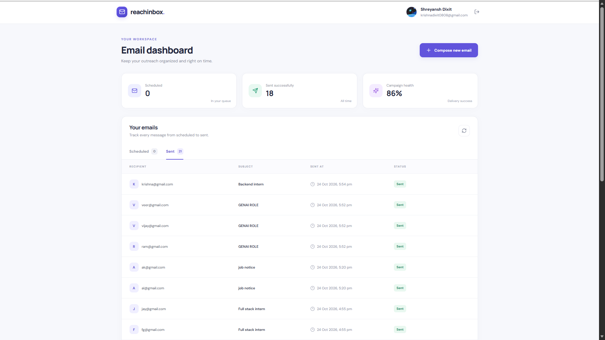
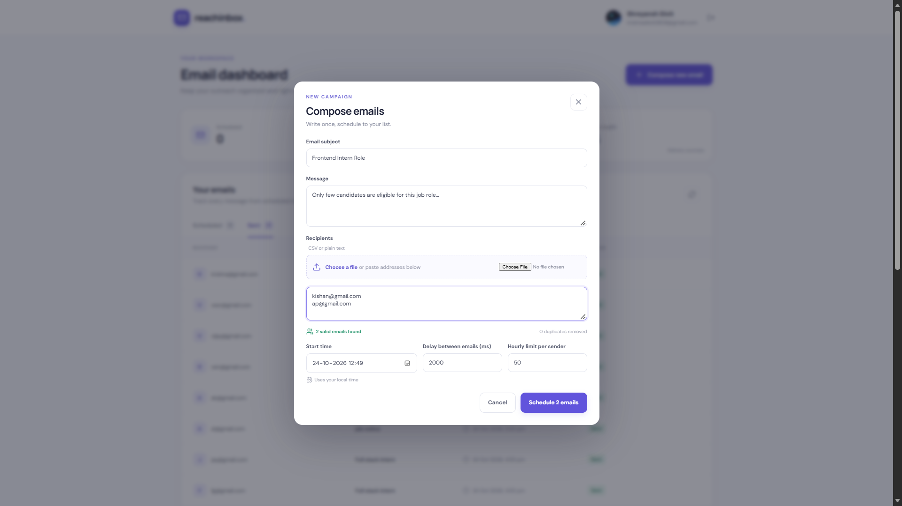
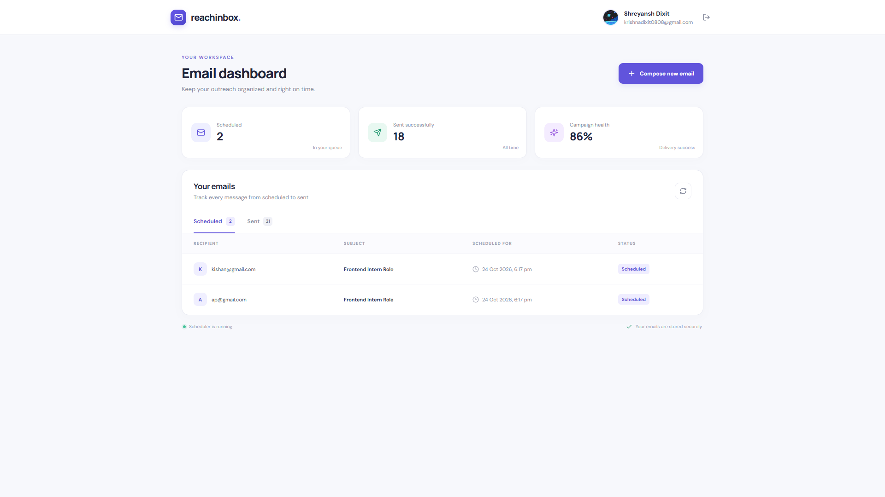
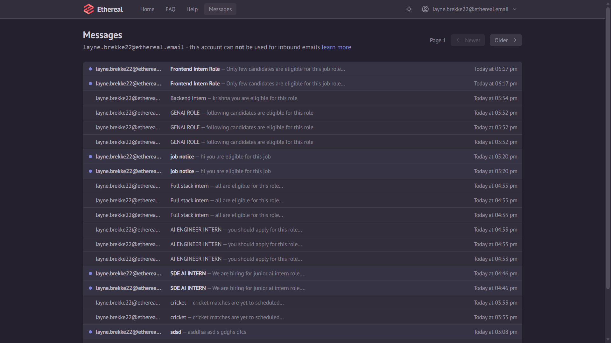
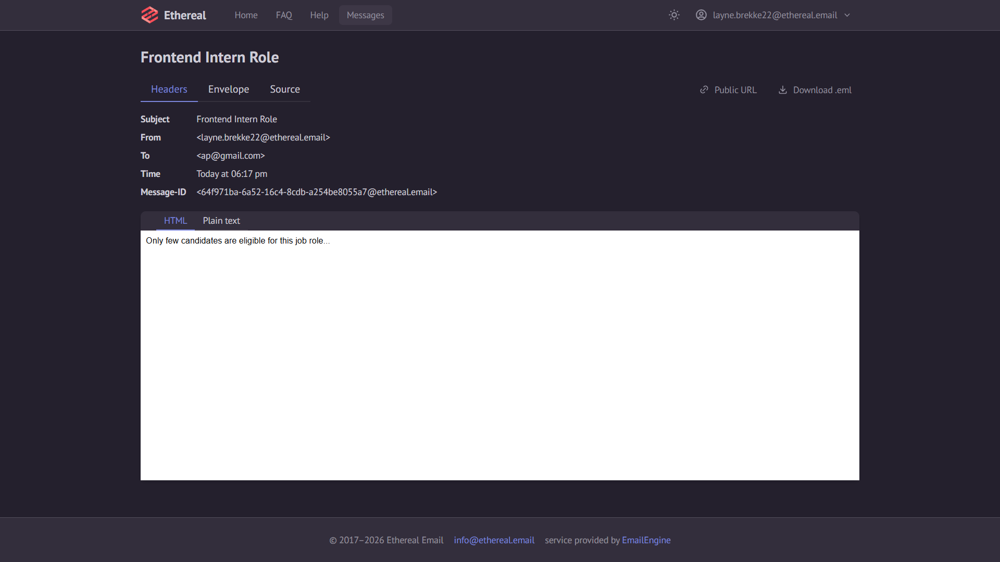

# ReachInbox Email Scheduler

## Live Demo & Video
- Live link: (https://reachinbox-scheduler-assignment-frontend.onrender.com/)
- Demo video: (https://drive.google.com/file/d/1qAE_pMYmGcSyghBmfOC8lw7KKCrKaRUS/view?usp=drive_link)


## Screenshots

### Application Overview

<table>
  <tr>
    <td align="center">
      <strong>Screenshot 1</strong><br/>
      
    </td>
    <td align="center">
      <strong>Screenshot 2</strong><br/>
      
    </td>
  </tr>
  <tr>
    <td align="center">
      <strong>Screenshot 3</strong><br/>
      
    </td>
    <td align="center">
      <strong>Screenshot 4</strong><br/>
      
    </td>
  </tr>
  <tr>
    <td align="center">
      <strong>Screenshot 5</strong><br/>
      
    </td>
    <td align="center">
      <strong>Screenshot 6</strong><br/>
      
    </td>
  </tr>
  <tr>
    <td colspan="2" align="center">
      <strong>Screenshot 7</strong><br/>
      
    </td>
  </tr>
</table>


## Tech Stack
- Backend: TypeScript, Express, PostgreSQL, BullMQ, Redis, Nodemailer, Zod, Passport Google OAuth
- Frontend: React, TypeScript, Vite, CSS
- Infrastructure: Docker Compose
- Email provider: Ethereal Email test SMTP

## How to Run

### 1. Start Redis + Postgres

From the repository root:

```bash
docker compose up -d
```

### 2. Backend (API)

```bash
cd backend
cp .env.example .env
npm install
npm run dev
```

Fill in the Google OAuth and Ethereal credentials in `backend/.env`. The API initializes the database schema on startup. The local database defaults in `.env.example` match `docker-compose.yml`.

### 3. Worker

Open another terminal:

```bash
cd backend
npm run worker
```

The worker is a separate process from the API. Redis keeps delayed jobs when either process restarts.

### 4. Frontend

Open another terminal:

```bash
cd frontend
npm install
npm run dev
```

The dashboard is available at `http://localhost:5173`. To use a different API host, set `VITE_API_URL` in `frontend/.env`.

## Ethereal Email & Environment Variables

Create a test inbox at [Ethereal Email](https://ethereal.email/) and copy its SMTP credentials into the backend environment. Ethereal captures messages for preview; it does not deliver them to real recipients.

| Variable | Purpose | Default |
| --- | --- | --- |
| `PORT` | API port | `5000` |
| `FRONTEND_URL` | Allowed frontend origin and OAuth redirect destination | `http://localhost:5173` |
| `DATABASE_URL` | PostgreSQL connection string | Local Compose database |
| `REDIS_URL` | Redis connection string | `redis://localhost:6379` |
| `SESSION_SECRET` | Session cookie signing secret | Must be replaced |
| `GOOGLE_CLIENT_ID` | Google OAuth client ID | Required for login |
| `GOOGLE_CLIENT_SECRET` | Google OAuth client secret | Required for login |
| `GOOGLE_CALLBACK_URL` | Registered Google callback URL | `http://localhost:5000/api/auth/google/callback` |
| `ETHEREAL_HOST` | SMTP host | `smtp.ethereal.email` |
| `ETHEREAL_PORT` | SMTP port | `587` |
| `ETHEREAL_USER` | Ethereal SMTP username | Required for sending |
| `ETHEREAL_PASS` | Ethereal SMTP password | Required for sending |
| `ETHEREAL_FROM` | Sender identity displayed in emails and used for rate limiting | `ReachInbox Scheduler <scheduler@example.com>` |
| `WORKER_CONCURRENCY` | Number of jobs a worker may process | `5` |
| `MIN_DELAY_BETWEEN_EMAILS_MS` | Minimum queue-wide send spacing | `2000` |
| `MAX_EMAILS_PER_HOUR_PER_SENDER` | Default hourly limit | `50` |
| `EMAIL_RETRY_ATTEMPTS` | Attempts before a send is marked failed | `3` |

In Google Cloud Console, create a Web application OAuth client, enable the required Google identity scopes, and add `http://localhost:5000/api/auth/google/callback` as an authorized redirect URI. Add the deployed callback URL when deploying. Use a long random session secret and never commit `.env` files.

## Architecture Overview

### How scheduling works

The API validates the payload with Zod, normalizes and deduplicates email addresses, inserts one row per recipient into PostgreSQL, and then uses BullMQ `addBulk` to enqueue delayed jobs. Each job uses its database UUID as `jobId`. The requested delay is spread across recipients so a batch does not all become eligible at once.

### How restart persistence works

PostgreSQL is the durable record of email status and Redis persistence stores BullMQ delayed jobs. Redis is configured with append-only persistence in Compose. Restart the API or worker without deleting the volumes to retain pending jobs. The code checks the database status and atomically claims a scheduled row before sending. SMTP cannot provide a strict exactly-once guarantee if the process crashes after the SMTP server accepts a message but before PostgreSQL records it; this boundary is an explicit limitation of using ordinary SMTP without provider-side idempotency.

### How rate limiting works

The hourly limiter uses a Redis Lua script to increment the sender/hour key only when the configured cap has not been reached. If no slot is available, the worker moves the BullMQ job to the start of the next UTC hour and raises BullMQ's `DelayedError`, so the job is delayed rather than dropped or kept in a polling loop. The limiter is shared across worker instances. Set `MAX_EMAILS_PER_HOUR_PER_SENDER` for the default and `hourlyLimit` in a scheduling request for a campaign-specific cap.

### How concurrency and delay work

`WORKER_CONCURRENCY` controls the worker concurrency. BullMQ's queue-wide limiter is configured from `MIN_DELAY_BETWEEN_EMAILS_MS` with one job per duration, keeping the send rate spaced even when several workers are running. The actual send rate is also constrained by the hourly Redis counter.

### What happens with 1000+ emails

The API accepts up to 5000 addresses per request, removes duplicates, stores the batch in a database transaction, and queues jobs using `addBulk` rather than waiting for the emails to send. Workers send at the configured pace. For example, at 200 emails per hour, 1000 messages will be spread across at least five hourly windows. Ethereal is a test service, so this demonstrates queue behavior rather than production SMTP throughput.

## API Endpoints

| Method | Endpoint | Purpose | Auth |
| --- | --- | --- | --- |
| GET | `/api/health` | Checks PostgreSQL and Redis | No |
| GET | `/api/auth/google` | Starts Google OAuth | No |
| GET | `/api/auth/google/callback` | Handles Google OAuth callback | OAuth flow |
| GET | `/api/auth/me` | Returns the current user | Yes |
| POST | `/api/auth/logout` | Ends the session | Yes |
| POST | `/api/emails/schedule` | Schedules a batch | Yes |
| GET | `/api/emails/scheduled` | Lists scheduled/processing emails | Yes |
| GET | `/api/emails/sent` | Lists sent/failed emails | Yes |

Example schedule request:

```json
{
  "subject": "Quick introduction",
  "body": "Hello, I wanted to get in touch.",
  "emails": ["first@example.com", "second@example.com"],
  "startTime": "2026-10-25T10:00:00Z",
  "delayBetweenMs": 2000,
  "hourlyLimit": 50
}
```

## Feature Checklist

### Backend
- [x] Schedule API + PostgreSQL storage
- [x] BullMQ delayed jobs, no cron or interval-based scheduling
- [x] Database UUID used as BullMQ job ID
- [x] Status check and atomic claim before send
- [x] Redis-backed hourly sender counters
- [x] Reschedule to next hour when limit is hit
- [x] Worker concurrency and send delay from environment
- [x] Zod request validation
- [x] SMTP retry and failed status
- [x] Health endpoint

### Frontend
- [x] Real Google OAuth flow (requires configured credentials)
- [x] Header with name, email, avatar and logout
- [x] Dashboard with Scheduled and Sent tabs
- [x] Compose modal with CSV/text upload and parsed address count
- [x] Scheduled and Sent tables with loading, empty and error states
- [x] Typed API client and component props
- [x] Duplicate removal and form validation

## Assumptions, Shortcuts & Trade-offs

- This is a single-user-per-session dashboard; each email row is scoped to the authenticated user.
- One configured Ethereal SMTP account is used by default. A sender is kept on each email row so the limiter is sender-scoped; multiple accounts can be added by extending sender selection and SMTP transport configuration.
- The UI uses custom CSS rather than a utility framework to keep the project setup small.
- The default session store is Express's in-memory store and is intended for local development. For deployment, configure a persistent PostgreSQL or Redis session store and secure cookie settings behind HTTPS.
- SMTP and PostgreSQL cannot participate in one atomic transaction. A crash after SMTP acceptance but before the status update can create an ambiguous delivery result; provider-level idempotency or an outbox/provider reconciliation strategy would be needed for a strict production guarantee.
- Google OAuth and Ethereal sending cannot be verified until real credentials are supplied. Run the restart and rate-limit tests before marking the assignment complete.

## Manual Verification

1. Sign in using Google OAuth.
2. Schedule two or three test addresses for a few minutes in the future.
3. Stop and restart the API and worker while Redis and PostgreSQL remain running.
4. Confirm the delayed jobs are retained and that the dashboard status updates after delivery.
5. Temporarily set the hourly limit to `2`, schedule more than two addresses, and inspect worker logs and Redis keys to verify that later jobs are moved to the next hour.
6. Check the Ethereal preview URL printed by the worker.
